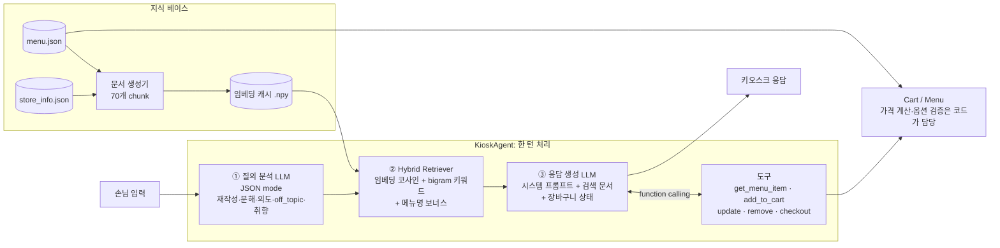

# ☕ 카페 소담: RAG 기반 키오스크 자연어 인터페이스

손님이 글로 대화하며 메뉴 문의, 추천, 옵션 선택, 주문, 결제를 하는 LLM 키오스크입니다.
OpenAI API(Chat Completions, Embeddings, JSON mode, Function Calling)와 RAG를 사용합니다.

## 실행

```bash
pip install -r requirements.txt
export OPENAI_API_KEY=sk-...
# (선택) export OPENAI_MODEL=gpt-4o-mini

python main.py --debug          # 터미널 키오스크 (/cart, /debug, /reset, /quit)
streamlit run app.py            # 시연용 웹 UI (장바구니 + RAG 내부 동작 패널)

python -m tests.test_offline    # API 키 없이 가격·검증·장바구니·검색 테스트
python -m tests.run_scenarios   # HTI 시나리오 23개 실행 → tests/scenario_report.md
```

## 1. 시스템 구성도



| 계층 | 파일 | 역할 |
|---|---|---|
| 데이터 | `data/menu.json`, `data/store_info.json` | 메뉴 28종, 옵션 10종, FAQ, 추천 가이드 (사람이 관리하는 원본) |
| 문서화 | `kiosk/documents.py` | 구조화 데이터를 RAG용 자연어 문서로 변환 |
| 검색 | `kiosk/retriever.py` | Hybrid 검색, 복합 질의용 multi-search |
| 도메인 로직 | `kiosk/menu.py`, `kiosk/order.py` | 가격 계산, 옵션 유효성 검사, 장바구니, 결제 |
| LLM | `kiosk/prompts.py`, `kiosk/agent.py` | 2단계 프롬프트 파이프라인 + 도구 호출 루프 |
| UI | `main.py`, `app.py` | CLI / Streamlit |

### 핵심 설계 원칙: 설명은 LLM이, 숫자와 규칙은 코드가

RAG는 근거를 주지만 LLM이 가격을 잘못 합산할 수는 있습니다. 그래서 **장바구니 가격과 옵션 가능 여부는 `Menu.price`, `Menu.validate`가 계산**하고, LLM은 도구가 돌려준 결과를 전달만 합니다.
그 결과 "가격을 100원으로 해줘" 같은 인젝션에도 금액이 바뀌지 않습니다.

## 2. RAG 문서 구성 (총 70개 chunk)

| 문서 유형 | 개수 | 단위 | 담긴 정보 | 대응하는 질문 |
|---|---|---|---|---|
| 메뉴 | 28 | 메뉴 1개 | 설명, **사이즈별 가격(미리 계산)**, 온도, 진하기·단맛·카페인·칼로리, 알레르기, **선택 가능/불가 옵션**, 태그, 페어링, 판매 상태 | 정보, 가격, 옵션, 비교 |
| 옵션 | 10 | 옵션 그룹 | 선택지, 추가금, 적용 가능 메뉴(역색인), 사이즈 별칭(중간=Grande) | "시럽 추가 돼요?" |
| 카테고리 | 6 | 카테고리 | 메뉴 목록 + 시작가 | "디저트 뭐 있어요?" |
| 추천 가이드 | 12 | 선호 유형 | 달콤한/상큼한/진한/카페인 없는/저칼로리/어린이/날씨/페어링 | 추천 |
| 순위 | 4 | 속성 | 단맛·진하기·카페인·칼로리 순위 | "제일 단 거?" |
| 매장 FAQ | 10 | Q&A 1쌍 | 영업시간, 결제, 텀블러, 디카페인, 알레르기, 환불, 스탬프 | 매장 정보 |

설계 포인트
- **원본은 JSON, 문서는 자동 생성**: 가격을 바꾸면 문서, 임베딩, 주문 로직이 함께 갱신됩니다 (문서와 실제 가격이 어긋나지 않음).
- **메뉴 1개 = 문서 1개**: 한 메뉴에 대한 질문은 문서 1개만 찾으면 답할 수 있게 해서 chunk 경계 문제를 없앴습니다.
- **"불가 옵션"과 "품절"도 문서에 명시**: LLM이 안 되는 옵션을 된다고 답하는 것을 막습니다.
- **수치 프로필(진하기 1~5)과 근거 문장**: "뭐가 더 진해요?" 같은 비교 질문에 근거를 갖고 답합니다.

## 3. 세부 요구사항 충족 방식

| 요구사항 | 구현 |
|---|---|
| 메뉴 정보 제공 | 메뉴 문서 + `get_menu_item` 도구(검색이 빗나갔을 때 정확히 다시 조회) |
| 음료 추천 | 질의 분석이 `preferences`를 뽑아 검색어에 추가 → 추천 가이드·순위 문서 검색 → 이유와 함께 1~3개 추천 |
| 옵션 선택/정보 | 문서의 가능/불가 옵션 + `Menu.validate`가 불가 옵션 주문을 차단하고 대안 안내 |
| 복합 질의 | **Query Decomposition**: sub_queries로 나눠 각각 검색 후 합침 + "요청을 하나도 빠뜨리지 말 것" 규칙 |
| 다양한/이상한 질문 | `off_topic` 분류 → 검색 생략, 정중히 거절하고 주문으로 유도. 모호하면 되묻기, 없는 메뉴는 대안, 인젝션 방어 |
| HTI | `docs/HTI.md` (8개 상위 task, 40여 개 하위 task) → `tests/scenarios.json` 23개 테스트 |

### 사용한 Prompt Engineering 기법 / OpenAI API 기능

| 기법 | 위치 |
|---|---|
| Role/Persona prompting ("소담이") | `SYSTEM_PROMPT` |
| Grounding (검색 문서·도구 결과만 근거로 사용) | `SYSTEM_PROMPT` 정보 근거 규칙 |
| Query Rewriting (대화 맥락으로 대명사 복원) | `QUERY_ANALYSIS_PROMPT` |
| Query Decomposition (복합 질의 분해) | `QUERY_ANALYSIS_PROMPT` → `multi_search` |
| Intent Classification | `QUERY_ANALYSIS_PROMPT` |
| Few-shot examples | 두 프롬프트 모두 |
| Slot Filling (사이즈·온도 되묻기) | `SYSTEM_PROMPT` + `Cart.add`의 `need_more_info` |
| Self-check 체크리스트 | `SYSTEM_PROMPT` 마지막 부분 |
| Structured Output (JSON mode) | `agent.analyze` |
| Function Calling (6개 도구, 병렬 호출 지원) | `agent.TOOLS` |
| Embeddings (`text-embedding-3-small`) + 캐시 | `retriever.py` |
| temperature 조절 (분석 0, 응답 0.3) | `agent.py` |

## 4. 약점 및 추후 개선점

| 약점 | 개선 방향 |
|---|---|
| 턴마다 LLM을 2번 이상 호출해서 지연과 비용이 늘어남 | 단순 질의는 분석 단계 생략(라우팅), 스트리밍 응답, 작은 모델로 분석 |
| 임베딩을 메모리에서 numpy로 검색 (메뉴 수백 개까지만 적합) | 메뉴가 늘면 Vector DB(Chroma, FAISS)와 메타데이터 필터 사용 |
| 결제 확인을 프롬프트에만 의존 | 상태 머신(주문 → 확인 → 결제)으로 코드가 강제 |
| 품절·재고가 정적 JSON | POS·재고 시스템과 실시간 연동 |
| 추천이 규칙 기반 가이드 문서 위주 | 주문 이력·시간대·날씨를 반영한 개인화 |
| 텍스트 입력만 지원 | 음성(STT/TTS), 메뉴 이미지, 다국어 |
| 자동 평가가 부분적 (문자열·합계 검사) | LLM-as-judge 평가, 검색 정확도(Recall@k) 측정 |
